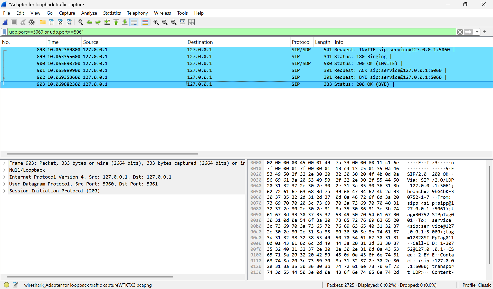
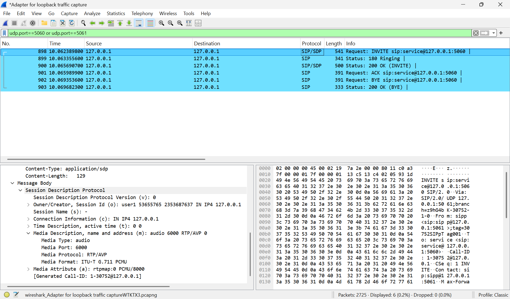
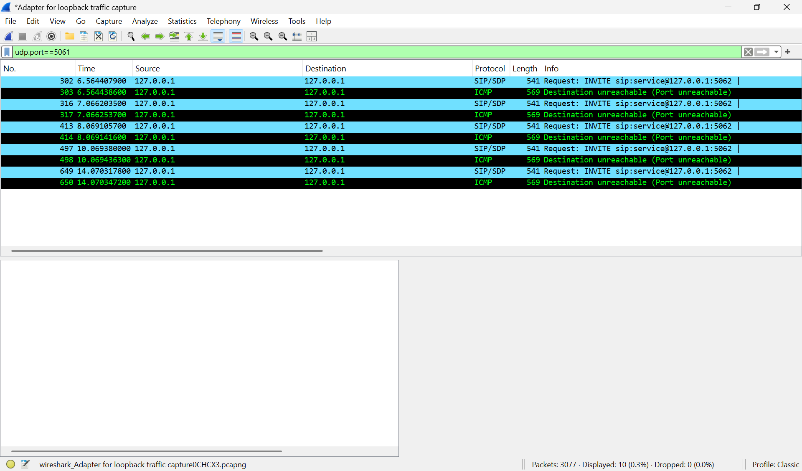
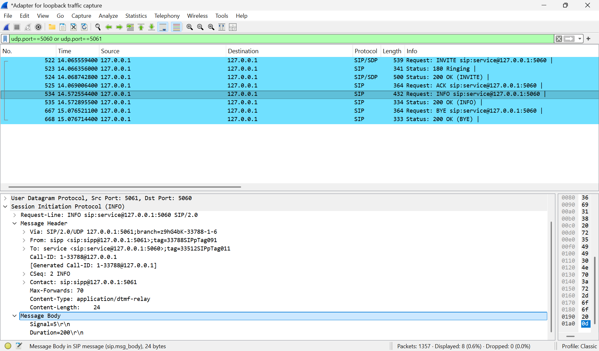

# SIP/RTP Call Flow Analysis using Wireshark and SIPp

Hands-on analysis of SIP call signaling — both a successful call and a failed
call — captured locally with Wireshark, using the open-source SIPp tool to
generate real SIP traffic.

## Objective

Understand and document how a SIP call is established, negotiated, and torn
down at the packet level, and how a failed call looks different from a
successful one when there's no listener on the target port.

## Tools Used

- **Wireshark 4.6.9** — packet capture and protocol analysis
- **SIPp** (built from source as `sipp-rs`, the official Rust port, via
  Rust/Cargo on Windows) — SIP traffic generator (UAC/UAS roles)

## Lab Setup

- Local UAC (caller) and UAS (callee), both bound to `127.0.0.1`, communicating
  over UDP.
- Captured on the Npcap Loopback Adapter.
- Display filter `udp.port==5060 or udp.port==5061` used to isolate SIP
  signaling from unrelated local loopback traffic.

```
UAC (127.0.0.1:5061) <----UDP----> UAS (127.0.0.1:5060)
```

## Scenario 1 — Successful Call

Command used:
```
# UAS
sipp-rs -sn uas -i 127.0.0.1 -p 5060

# UAC
sipp-rs -sn uac 127.0.0.1:5060 -i 127.0.0.1 -p 5061 -m 1
```

| # | Frame | Message | Description |
|---|-------|---------|-------------|
| 1 | 898 | INVITE | Call setup request. SDP offer: G.711 PCMU, port 6000 |
| 2 | 899 | 180 Ringing | Provisional response |
| 3 | 900 | 200 OK | Call accepted. SDP answer: G.711 PCMU, port 6000 (matched) |
| 4 | 901 | ACK | Handshake complete, call established |
| 5 | 902 | BYE | Call teardown initiated |
| 6 | 903 | 200 OK | Teardown confirmed |






**Finding**: The UAC offered G.711 PCMU and the UAS accepted it exactly as
offered — a clean codec negotiation with no mismatch or renegotiation
required.

## Scenario 2 — Failed Call (no listener on target port)

Command used:
```
sipp-rs -sn uac 127.0.0.1:5062 -i 127.0.0.1 -p 5061 -m 1 -timeout 10s -timeout_error
```
(Port 5062 deliberately had no UAS listening.)



- Wireshark shows **5 total INVITE attempts** (1 original + 4 retransmissions)
  sent at increasing intervals, matching SIP's standard exponential backoff
  retransmission timer (RFC 3261 Timer A).
- Each INVITE triggered an **ICMP "Destination Unreachable (Port
  Unreachable)"** response, confirming at the network layer that nothing was
  bound to that port.
- SIPp logged `uac timed out after '10.005' seconds` once the configured
  global timeout was reached.

```
2026-10-26      17:35:39.470198 1793016339.470198: uac timed out after '10.005' seconds

                                 Messages  Retrans   Timeout   Unexpected-Msg
0 :      INVITE ---------->         1         4         0
...
------------------------------ Test Terminated --------------------------------
```

**Finding**: This distinguishes a *port-unreachable failure* (explicit ICMP
rejection from the OS) from a *silent timeout* (e.g. a firewall dropping
packets with no response at all) — an important distinction when
troubleshooting real VoIP call failures.

## Scenario 3 — DTMF Signaling via SIP INFO (application/dtmf-relay)

Custom SIPp scenario: [`scenarios/uac_info_dtmf.xml`](scenarios/uac_info_dtmf.xml)

Command used:
```
# UAS (with automatic 200 OK for INFO/NOTIFY/OPTIONS/UPDATE)
sipp-rs -sn uas -i 127.0.0.1 -p 5060 -aa

# UAC (custom scenario sending a DTMF digit via SIP INFO)
sipp-rs -sf scenarios/uac_info_dtmf.xml 127.0.0.1:5060 -i 127.0.0.1 -p 5061 -m 1
```

**Why SIP INFO instead of RFC 2833 (in-band RTP DTMF)?** The first attempt
used SIPp's built-in `play_pcap_audio`/`play_dtmf` actions (which generate
RFC 2833 telephone-events over RTP) via the official `uac_pcap.xml` example
scenario. Both failed on Windows with:

```
Can't create raw IPv4 socket (need to run as root?): An attempt was made to
access a socket in a way forbidden by its access permissions.
```

This is a real platform constraint — SIPp's RTP/PCAP-play features need raw
socket access (root on Linux, Administrator on Windows), which wasn't
available in this environment. Rather than work around a permissions
restriction, the scenario was rebuilt around **SIP INFO-based DTMF relay**
(`application/dtmf-relay`) instead — a real, production-used alternative to
RFC 2833 (the same method Cisco CUCM/CUBE support) that only needs ordinary
SIP signaling, no RTP or raw sockets at all.


| # | Frame | Message | Description |
|---|-------|---------|-------------|
| 1 | 522 | INVITE | Call setup request |
| 2 | 523 | 180 Ringing | Provisional response |
| 3 | 524 | 200 OK | Call accepted |
| 4 | 525 | ACK | Handshake complete |
| 5 | 534 | **INFO** | DTMF relay: `Signal=5`, `Duration=200` |
| 6 | 535 | 200 OK | INFO acknowledged (via UAS `-aa` flag) |
| 7 | 667 | BYE | Call teardown initiated |
| 8 | 668 | 200 OK | Teardown confirmed |



**Finding**: The `INFO` request body confirms the DTMF relay payload exactly
as sent:
```
Content-Type: application/dtmf-relay
Signal=5
Duration=200
```
This demonstrates an out-of-band, signaling-layer DTMF method distinct from
RFC 2833's in-band RTP approach — both are used in real VoIP deployments, and
recognizing which one is in play is a practical troubleshooting skill (e.g.
diagnosing a DTMF issue requires knowing whether to look at RTP telephone-events
or at SIP INFO bodies).

## Key Takeaways

- Practiced isolating SIP signaling from unrelated background traffic using
  Wireshark display filters.
- Verified SDP codec negotiation directly from captured packets rather than
  assuming it from configuration.
- Observed SIP's retransmission/backoff behavior on an unanswered INVITE, and
  learned to distinguish a network-layer rejection (ICMP port unreachable)
  from an application-layer timeout.
- Wrote a custom SIPp XML scenario to generate a specific SIP method (`INFO`)
  with a custom body, rather than relying only on built-in scenarios.
- Hit a real platform constraint (Windows raw-socket restrictions blocking
  RFC 2833 RTP-based DTMF) and adapted by using SIP INFO-based DTMF relay
  instead — the same production method used by Cisco CUCM/CUBE.
